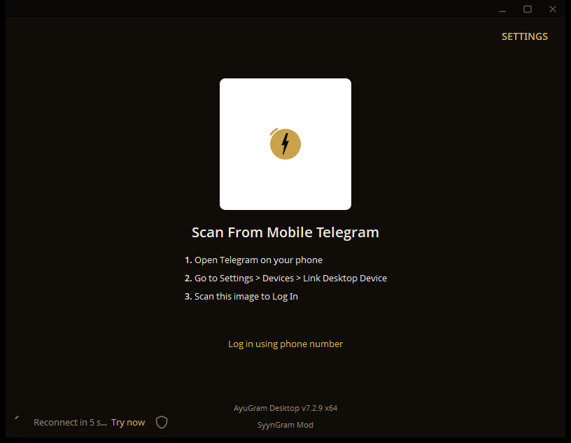
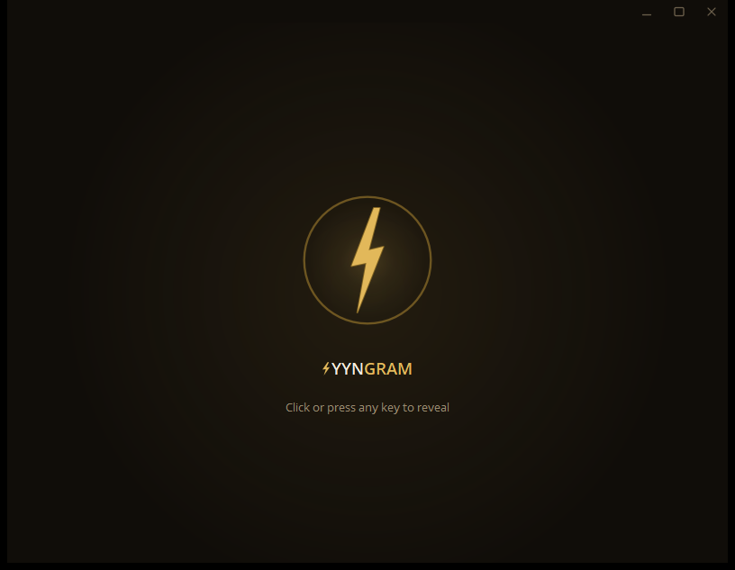
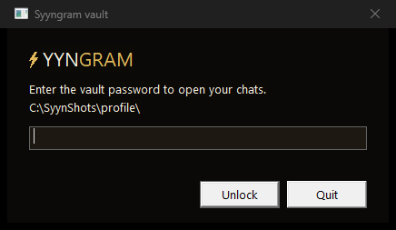
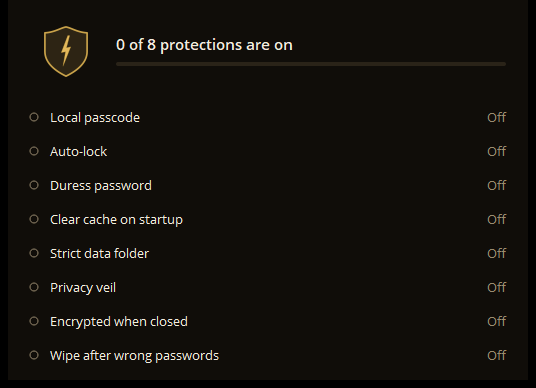
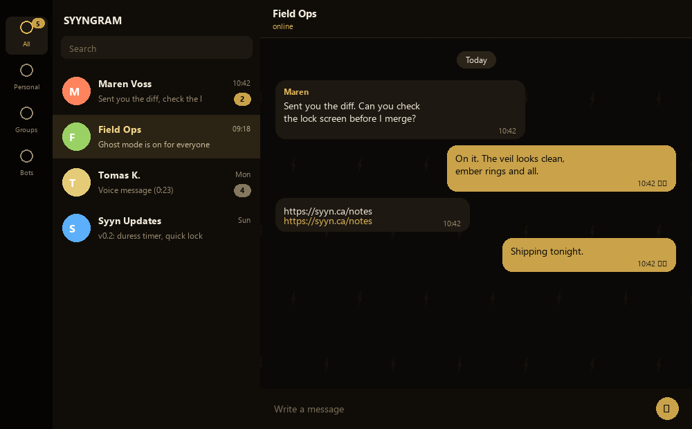
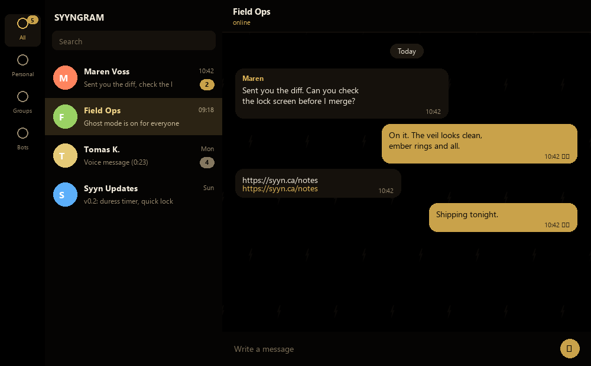
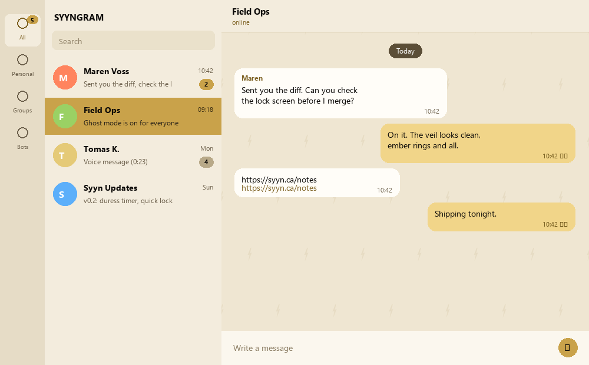
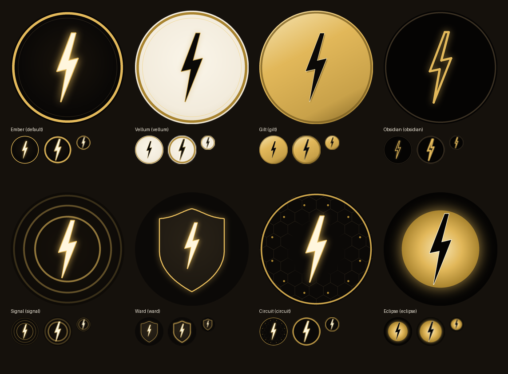

# SyynGram

SyynGram Mod is a fork of [AyuGram Desktop](https://github.com/AyuGram/AyuGramDesktop) 7.2.9, which is itself a
fork of [Telegram Desktop](https://github.com/telegramdesktop/tdesktop). It keeps everything AyuGram does and adds
a security layer, a dark gold theme pack and a few conveniences. Windows x64 is the supported platform. The current
release is [v0.1.0](https://github.com/dboudreau00/SyynGramDesktop/releases/latest).

> **Read this first.** SyynGram inherits AyuGram's features that go against Telegram's Terms of Service (ghost
> mode, anti-recall, local Premium and others), and Telegram can restrict accounts that use unofficial clients.
> The security features are tools with limits, listed in [Limits and honest notes](#limits-and-honest-notes).
> Binaries are unsigned. This project is not affiliated with Telegram or with the AyuGram project.

## Screenshots

| Sign-in | Privacy veil |
| --- | --- |
|  |  |
| **Vault password prompt** | **Security checkup** |
|  |  |

Themes, left to right: Ember, Obsidian, Vellum. These are previews rendered from the theme files with sample
chats, not captures of a live account.

| Ember | Obsidian | Vellum |
| --- | --- | --- |
|  |  |  |

The eight app icons, each drawn at its own sizes so it stays readable at 16 px:

## Download (Windows x64)

1. Get `Syyngram-0.1.0-win64.zip` from the [Releases tab](https://github.com/dboudreau00/SyynGramDesktop/releases)
   and compare its SHA-256 with the one in the release notes.
2. Unzip it anywhere and run `AyuGram.exe`. The executable is still called `AyuGram.exe`.
3. SmartScreen will ask for confirmation because the file is not signed.

The build is portable: the profile (`tdata`) is kept next to the executable. Only if that folder is not writable
does the app fall back to `%APPDATA%\AyuGram Desktop`, the same folder an upstream AyuGram install uses, so do not
run both against one profile, especially with the vault on.

There is no auto-update. To update, download the new zip and replace the program files, keeping `tdata`.

macOS and Linux packages are not published. The vault, the VeraCrypt helper and the purge helper are Windows only.
The package-manager install lines in the upstream AyuGram README (winget, scoop, brew, AUR and so on) install
upstream AyuGram, not this fork, so they are not listed here.

## What SyynGram adds

### Security

Everything below is under **Settings, AyuGram Preferences, General**. The security checkup and the veil are in the
**Security checkup** block, the rest is under **Storage**.

| Feature | What it does | Default |
| --- | --- | --- |
| Security checkup | A card with eight rows and a bar: local passcode, auto-lock, duress password, clear cache on startup, strict data folder, privacy veil, encrypted when closed, wipe after wrong passwords. It reports what is switched on; it does not test that it works. | n/a |
| Privacy veil | Covers the chats with a calm screen when the window loses focus. Options: Off, Immediately, After 5 seconds, After 30 seconds, After 2 minutes. Click or press a key to reveal. "Lock with passcode when the veil appears" also locks the app if a local passcode is set. "Show the veil now" previews it. | Off |
| Encrypt data when closed (vault) | Encrypts the whole profile while the app is closed and asks for a password at launch. See below. Windows only. | Off |
| Wipe everything after 5 wrong passwords | Five wrong attempts at the local passcode or the vault password start the duress wipe, silently. See below. | Off |
| Program to start on duress | An `.exe` you choose, started after a duress wipe. | None |
| Duress password | A second passcode that runs the wipe when typed on the lock screen. Needs a local passcode. | None |
| Zip files saved with Save As (7-Zip) | Packs files you save with Save As into an encrypted `.7z`. See below. | Off |
| Require data folder (strict) and Data folder | Never start with a default profile if the chosen data folder is missing. | Off |
| Mount VeraCrypt volume | Starts VeraCrypt to mount a volume you choose on drive `V:`. Windows only. | n/a |
| Clear cache on startup, Clear emoji cache on startup, Clear Ayu history database on startup | Removes those files before the app opens them. | Off |

#### The vault

Turn it on under **Encrypt data when closed** and choose a password of 8 to 256 characters. From then on:

* When you quit the app normally, every file under `tdata` becomes `<name>.sv`, encrypted with AES-256-GCM in 64 KiB
  chunks. The key comes from your password with PBKDF2-HMAC-SHA512 (600,000 iterations). Small plain files are
  overwritten before they are deleted.
* When you start the app, a small native window asks for the password before anything is read. A wrong password
  shows "That is not the password."; Quit exits.
* A second copy started while the first is opening or closing the profile waits and does not touch the files.
* **Keep media caches (encrypted, slower to close)** is off by default, which means the caches are deleted at close
  instead of encrypted.

What it does not do: while the app is running the files are plain on disk, so a crash, a kill or a power cut
leaves them readable until the next normal close. There is no password recovery; if you forget it, the encrypted
profile is gone and you sign in again. It covers `tdata` only, not downloads, files you saved, logs, or the small
settings file at `%APPDATA%\Syyngram\config.json`.

#### Wipe after five wrong passwords and the duress sequence

With the switch on, wrong attempts are counted on the lock screen and at the vault prompt. The count is kept on
disk, so closing or killing the app does not reset it, and any correct password (typed passcode, Windows Hello,
vault password) clears it. The fifth wrong attempt, or the duress password, runs the sequence with no message at
any step:

1. If the app is running, it asks Telegram to log out every account (best effort, about one second). A trigger at
   launch skips this, so the sessions stay open until you end them from another device.
2. Every file directly under `tdata` (keys, settings) is overwritten once and deleted first.
3. The rest of the profile, the logs, the AyuGram and SyynGram folders under `%APPDATA%` and the folders
   `AyuGram Desktop`, `AyuGram`, `Syyngram`, `Syyngram Desktop` and `Telegram Desktop` under Downloads are wiped.
4. The chosen program is started, detached.
5. A helper script deletes the program files, shortcuts and the uninstall entry, and the app exits. Your own files in the program folder, including a folder named `data`, are left alone.

It is irreversible, and a single overwrite pass does not reach every cell of an SSD or a synced or backed-up
folder. The duress password is not checked at the vault prompt, only on a lock screen.

#### 7-Zip on Save As

When this is on, a document you save with **Save As** is packed with 7-Zip into `<name>.7z` with encrypted file
names, using the password from **Zip password**, and the plain copy is deleted. The password goes to 7-Zip on
standard input, never on a command line. If 7-Zip is not installed, the file is saved as it is and you are told. It
looks in Program Files and the registry, then for `7z.exe` on the PATH. The password must use plain keyboard
characters, because 7-Zip reads it in the console code page, and it is stored unmasked in `ayu_settings.json` (the
vault covers that file when it is on). Photos, normal downloads and Save As on a file the media viewer already has
on disk are not packed.

#### Data folder and VeraCrypt

A data folder on a mounted encrypted volume keeps the profile unreadable when the volume is dismounted. With the
strict switch on, the app shows a Retry or Cancel box instead of silently creating a second profile when the volume
is missing. If you used **Mount VeraCrypt volume** once, the app also tries to mount that volume at start and waits
up to 20 seconds for the folder. The vault is the built-in alternative that needs nothing else installed. See
[docs/veracrypt.md](docs/veracrypt.md).

### Look

* **Themes.** Ember (dark, the default night theme), Obsidian (OLED black), Vellum (light), plus the stock Classic.
  A fresh install starts in Ember in night mode and in Vellum in day mode (night mode follows the system setting by
  default). Gold is the default accent, with eight gold-family swatches.
* **Icons.** Eight app icons in the icon picker: Ember (default), Vellum, Gilt, Obsidian, Signal, Ward, Circuit,
  Eclipse.
* **Animations and sign-in.** 36 of the stock illustrated animations are recoloured to gold, three new bolt
  animations are added, and the sign-in QR has a gold centre with the bolt. Every theme ships a tiled wallpaper of
  small bolts.
* **Branding.** "SyynGram Mod" appears as a second line under "AyuGram Desktop" in the sign-in footer, the side
  menu, the About box and the settings header. The wordmark uses the bolt as its S.

### Removed

* **The updater** is disabled at runtime, so there are no update checks or downloads and the update rows in Settings
  are hidden. An "update required" prompt would open the upstream AyuGram releases channel, not this project.
* **The remote config fetch** (AyuGram's server and the fallback to a third-party one, at start and every hour) is
  no longer started. Supporter lists and badges use built-in defaults.

The app is not network-silent: the AyuGram language pack is still fetched from a CDN at startup, translation
providers and the filter-sharing service are contacted when you use them, and Telegram traffic is Telegram traffic.

## Limits and honest notes

* It is still AyuGram at the OS level: `AyuGram.exe`, window titles, tray text, notifications and the installer
  names say AyuGram. The version shown in the app is AyuGram's 7.2.9; SyynGram's release number is the tag.
* Early release. Before v0.1.0 the vault, the wipe, the 7-Zip pack and the purge helper were exercised on
  throwaway profiles; the focus-loss trigger of the veil, the VeraCrypt auto-mount and the installer were not
  covered by that testing. Do not rely on the wipe or the vault as your only protection.
* The wipe also deletes the official Telegram Desktop folder under Downloads, and a program you choose for the
  duress start must live outside the app's folders (and outside the AppData and Downloads folders it wipes).
* The veil is an overlay on the app's windows, not an operating-system lock. It does not cover the media viewer.
* The checkup reports switches, not results, and has no row for 7-Zip.
* The installer script (`Telegram/build/setup.iss`) installs `Telegram.exe` while the build produces
  `AyuGram.exe`, so it is unverified for this fork; the release is a portable zip.

## Build from source

The Windows build follows [docs/building-win.md](docs/building-win.md), with these differences for this fork:
clone `https://github.com/dboudreau00/SyynGramDesktop.git` with `--recursive`, and see
[docs/api_credentials.md](docs/api_credentials.md) for the API id and hash. You need Visual Studio with the
v143 14.44 toolset, ATL and MFC, the Windows 10.0.26100.0 SDK, Python 3.10 and Git. Run
`Telegram\build\prepare\win.bat` from a Native Tools prompt to build the libraries, then
`Telegram\configure.bat x64`, then build `Telegram` in Debug or Release. The output is `AyuGram.exe`.

Contributor rules are in [AGENTS.md](AGENTS.md) and [REVIEW.md](REVIEW.md). Two sets of helpers live in `tools`:

* `tools/phase0_security` holds small Python contract tests for the wipe, the data folder and the cache cleanup. They
  mirror the C++ path rules and do not build the app. Run one with
  `python tools/phase0_security/test_phase2_duress_wipe.py -v`.
* `tools/syyn_assets` regenerates the icons, themes and animations. See its [README](tools/syyn_assets/README.md).
  The scripts overwrite files in place and the animation and theme steps need the stock originals, so work on copies.

Where the code is: the vault in `Telegram/SourceFiles/storage/storage_vault.cpp` and
`platform/win/vault_prompt_win.cpp`, the wipe in `storage/storage_duress*.cpp`, the veil and 7-Zip in
`ayu/features/veil` and `ayu/features/zip`, and the settings rows in `ayu/ui/settings/settings_general.cpp`.

## Inherited from AyuGram

All of AyuGram's features are still here: full ghost mode, messages history, anti-recall, font customization,
streamer mode, local Telegram Premium, the translator, media preview and quick reaction on force click (macOS),
enhanced appearance, message filters and more. See the [AyuGram documentation](https://docs.ayugram.one/desktop/).

## Credits and licence

SyynGram is free software under the GNU General Public License version 3, with the OpenSSL linking exception of
Telegram Desktop. See [LICENSE](LICENSE) and [LEGAL](LEGAL). If you distribute binaries you must offer the source,
which is this repository. Please keep the credit to the original authors: Telegram Desktop, and AyuGram Desktop by
Radolyn Labs and contributors.

If you want to support the upstream AyuGram authors, see [their donation page](https://docs.ayugram.one/donate/).
That is not a way to support SyynGram.

### Telegram clients

- [Telegram Desktop](https://github.com/telegramdesktop/tdesktop)
- [AyuGram Desktop](https://github.com/AyuGram/AyuGramDesktop)
- [Kotatogram](https://github.com/kotatogram/kotatogram-desktop)
- [64Gram](https://github.com/TDesktop-x64/tdesktop)
- [Forkgram](https://github.com/forkgram/tdesktop)

### Libraries used

- [JSON for Modern C++](https://github.com/nlohmann/json)
- [SQLite](https://github.com/sqlite/sqlite)
- [sqlite_orm](https://github.com/fnc12/sqlite_orm)
- [androidx sources](https://github.com/androidx/androidx)

### Icons

- [Solar Icon Set](https://www.figma.com/community/file/1166831539721848736)

### Bots

- [TelegramDB](https://t.me/tgdatabase) for username lookup by ID (until closing free inline mode at 2 April 2026)
